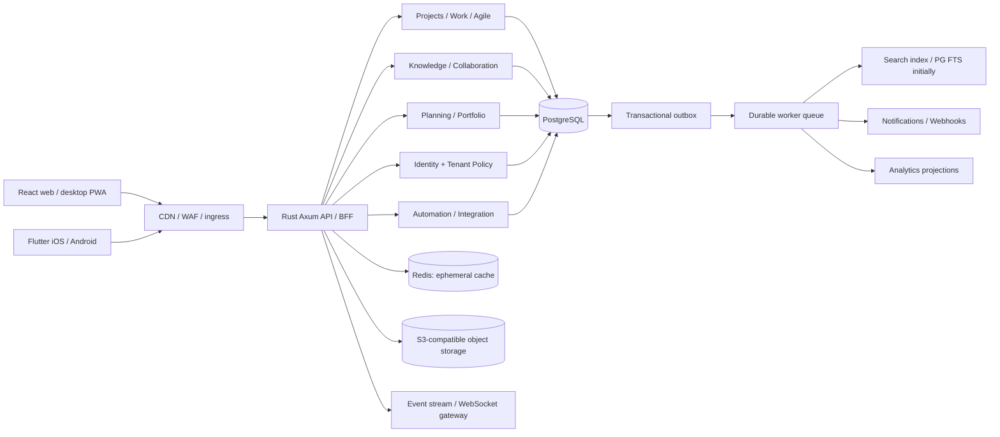

# Meridian — target architecture

> **Status:** Long-term design. The initial Rust modular monolith, PostgreSQL tables, React and Flutter interfaces are implemented in part; workers, Redis, object storage, CRDT collaboration, enterprise identity and production RLS are **not** implemented in the current package. See `IMPLEMENTATION_STATUS.md`.

## Architectural principles

1. **One product, one domain model:** Projects, work items, documents, discussions, approvals, people and goals link through typed relations. A project is not a silo and a document is not a detached attachment.
2. **Modular monolith first:** One Rust deployable with bounded crates (`identity`, `tenancy`, `work`, `knowledge`, `collaboration`, `planning`, `search`, `automation`, `billing`, `audit`, `integration`) and background workers. Extract services only for measured scaling, fault isolation or regulatory needs.
3. **Tenant boundary is enforced by identity, not the client's tenant header:** Session resolves tenant and membership. Every query includes tenant scope. Production needs PostgreSQL RLS as defense-in-depth, automated isolation tests and administrator-scoped impersonation audit.
4. **Postgres is the source of truth:** Normalized relational schema with scoped uniqueness, JSONB only for controlled extensions/custom field payloads, explicit relation tables. Attachments to object storage. Immutable events via outbox; do not make Redis a source of record.
5. **Sync and background work are distinct:** Postgres transaction commits work and outbox event together; workers deliver at-least-once with idempotency, retries and DLQ. SSE/WebSocket updates are hints; clients reconcile after reconnect.
6. **Performance is designed into data access:** Cursor pagination, tenant-leading composite indexes, select only required columns, bounded fan-out, request deadlines, bulk reads, idempotency keys, CPU-/IO-aware pools.
7. **Mobile uses a shared contract, not shared UI:** React + TypeScript desktop-first, Flutter iOS/Android responsive native navigation, encrypted local drafts, sync conflict handling, reduced-motion/accessibility.
8. **Secure by default:** OIDC/SSO, SCIM, MFA, user sessions, tenant RBAC + object ACL + ABAC, rate limits, CSP, CSRF if cookies used, audit logs, encryption, content sanitization, secret rotation.

## Target component diagram

## Bounded contexts

| Context | Owns | Critical invariants |
|---|---|---|
| Organizations | Tenant, plan, region, domains | A resource belongs to exactly one tenant unless explicitly federated |
| Identity | User, membership, credentials, role, session | Never trust tenant chosen in an arbitrary request header |
| Projects | Project, team, permissions, templates | Project key unique inside tenant |
| Work | Issue, status, workflow, link, comment, custom field, history | Updates append immutable history; finite workflow transitions |
| Agile | Backlog, sprint, board, estimation, release | Sprint closure handles carryover explicitly |
| Knowledge | Space, page, tree, live doc, version, asset | Historical versions reconstructable; page ACL applies to descendants |
| Collaboration | Thread, mention, watcher, inbox, activity | No information leaks via notification or search |
| Planning | Goal, initiative, dependency, milestone, capacity | Cross-project reporting scoped by tenant and permissions |
| Automation | Rule, trigger, action, quota, execution, retry | Idempotent actions with loop prevention |
| Intelligence | Search, permissions-aware context graph, AI jobs | Retrieval before generation; citations and source ACL enforcement |
| Platform | Billing, entitlements, usage, audit, integration, webhooks | Immutable billable events, audited administrator actions |

## Multi-tenant strategy

- Default: pooled regional Postgres clusters, shared physical tables with `tenant_id`, composite foreign keys, scope guards, RLS and automated cross-tenant negative tests.
- Large enterprise: dedicated database / cluster option, same logical schema and deployment artifacts.
- Region pinning: tenant's home region determines object storage, database, queue and indexes; asynchronous cross-region replication only under approved policy.
- Keys: per-region KMS, optional tenant-level envelope keys for regulated customers.
- Resource controls: per-tenant rate/cost budgets, queues, cardinality-limited telemetry, noisy-neighbor fairness.
- Tenant move: dual-read validation + brief write fence + complete export/import + checksums and rollback; never remap IDs without a durable mapping table.

## Core data model (target)

Tenant -> Membership <- User; Tenant -> Team -> TeamMember; Tenant -> Project -> WorkItem;
Project -> Board/Sprint/Release; Project -> Space -> Page -> PageRevision;
WorkItem -> Relation -> Page / WorkItem / Goal / Commit / TestRun;
WorkItem -> Comment/Attachment/TimeEntry/History/Approval;
Space -> Whiteboard/Database/Template; Tenant -> AutomationRule/Integration/Usage/Audit.

The implementation package includes only initial tenant/user/session/project/issue/page/version/audit tables; the target graph above is **not implemented yet**.

## Workflow and collaboration semantics

- Define state machine per issue type; transition constraints, guards, approval gates, validators and audit events.
- Documents: Yjs/Automerge-like CRDT editor protocol, one collaboration room per document, permission-checked snapshots, periodic compaction, snapshots and revision playback; separate publish workflow from live editing.
- Text search: start PostgreSQL FTS + trigram + ACL filtered queries; migrate high-scale search to OpenSearch/Meilisearch only when measured. Vector retrieval is optional and always permission-filtered.
- Presence: ephemeral; never rely on presence records to authorize writes.
- Document references: typed bidirectional links from one entity table. Deleted entities leave resolvable tombstone and audit evidence.

## Performance targets (SLOs, not measured claims)

- At warm steady-state, API GET p95 < 150 ms, mutation p95 < 300 ms under reference workloads, excluding slow third-party integrations.
- Web main dashboard interaction INP < 200 ms on mid-range devices, LCP < 2.5 s on representative networks.
- Board with 10k items: virtualize; initial visible viewport available < 1.5 s after navigation under test conditions.
- 99.9% monthly availability target for standard tier; higher SLO for contracted enterprise tier.
- No synchronous full-text reindex, report generation, or AI generation in request handlers.
- Database: index by tenant+query pattern, `EXPLAIN ANALYZE`, load test with skewed tenant sizes, protect connection pool against bursty workloads.
- Testing: k6 or Locust traffic mixes; Playwright Web Vitals; Flutter integration on real mid-range Android and iPhone devices; pgbench + failover scenarios.

## UI direction

- Product signature: calm, editorial precision; deep blue and clean neutrals with sparse semantic color.
- Information architecture: Home, My Work, Projects, Boards, Planning, Knowledge, Inbox, Insights, Automations, Administration.
- Fast navigation: command bar, keyboard-first actions, saved views, global filters and deep links; minimize modal depth.
- Responsive: desktop 3-pane layout where valuable, tablet adaptive layouts, native Flutter bottom navigation and action sheets.
- Accessibility: WCAG 2.2 AA target, full keyboard workflows, proper focus management, screen reader labeling, dark mode and reduced-motion support.
- Design system: tokens for spacing/type/color/elevation, accessible components, data grid, rich editor, chart and hierarchy primitives.

## Threat model and release gates

Threats: IDOR/cross-tenant leaks, forged membership, stale page write, data export misuse, XSS in rich docs, malicious file attachments, webhook SSRF, prompt-injection through indexed documents, workflow loops, OAuth token theft, billing race conditions.

Release gates: tenant-isolation fuzz/integration tests, role and ACL regression suite, mandatory security review, static analysis, dependency SBOM/signing, backup restore drill, multi-AZ failover, penetration test, audit log verification, DPA and retention flows. **Do not deploy the provided foundation as a production SaaS without these gates.**
